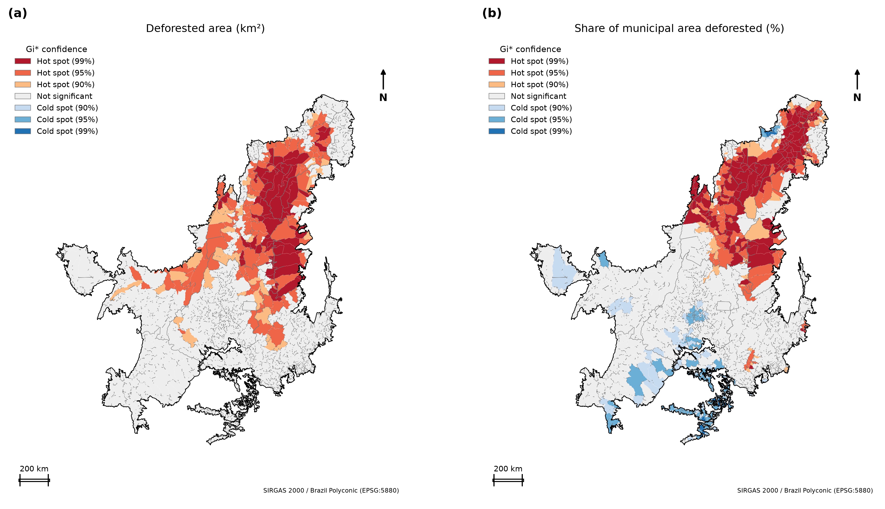
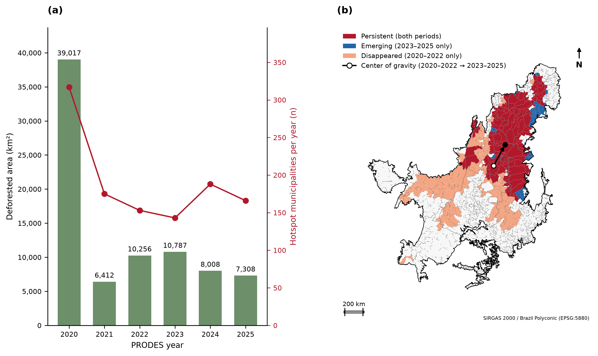
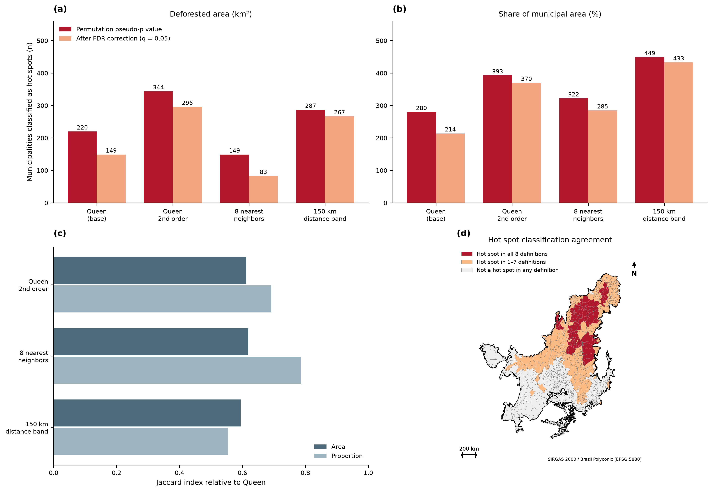
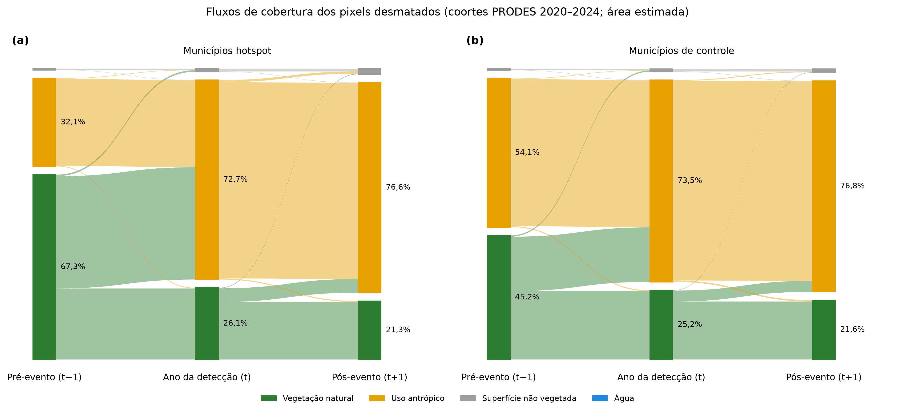
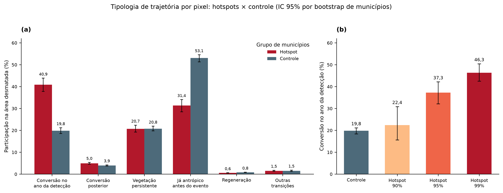
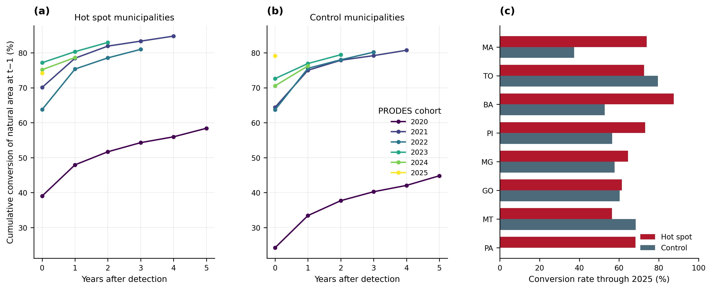
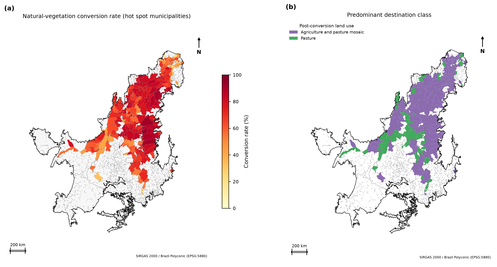

# Resultados e discussão

## 1. Panorama do desmatamento detectado

Entre 2020 e 2025, o PRODES detectou 81.788 km² de desmatamento no Cerrado, distribuídos em 1.972.375 interseções polígono–município. A distribuição anual é fortemente assimétrica (Tabela 1): o ano de 2020 responde por 48% da área e por 84% das interseções, com fragmentos de mediana igual a 0,011 km². Esse comportamento é tratado como limitação e como ponto de verificação junto ao provedor dos dados.

**Tabela 1.** Área desmatada e número de interseções por ano de detecção.

| Ano | Área (km²) | Interseções |
|---|---:|---:|
| 2020 | 39.017 | 1.663.654 |
| 2021 | 6.412 | 55.067 |
| 2022 | 10.256 | 69.083 |
| 2023 | 10.787 | 65.622 |
| 2024 | 8.008 | 59.391 |
| 2025 | 7.308 | 59.558 |

## 2. Hotspots de desmatamento (Getis-Ord Gi\*)

### 2.1 Distribuição espacial

Os dois indicadores apresentaram forte autocorrelação espacial positiva (I de Moran = 0,418 para a área e 0,644 para a proporção; 0,669 e 0,704 nas escalas logarítmicas; *p* = 0,001 em todos os casos), o que justifica a análise de agrupamentos locais.

**Figura 1.** Hotspots de desmatamento no Cerrado (Getis-Ord Gi\*), 2020–2025: (a) área desmatada (km²); (b) proporção da área municipal desmatada (%). Mapas com norte, escala gráfica e sistema de referência SIRGAS 2000 / Policônica do Brasil (EPSG:5880).

Na análise da área desmatada, 220 municípios foram classificados como *hot spot* (41 a 90%, 117 a 95% e 62 a 99% de confiança). Na análise da proporção, foram 280 *hot spots* (41, 106 e 133, respectivamente) e 253 *cold spots* (131 a 90%, 113 a 95% e 9 a 99%). A união dos dois critérios resultou em **348 municípios hotspot**, que somam 54.727 km², ou 66,9% de toda a área desmatada.

Os hotspots formam um corredor contínuo no Matopiba (sul do Maranhão, leste do Tocantins, sudoeste do Piauí e oeste da Bahia), com extensões no norte de Minas Gerais, em Goiás e no norte de Mato Grosso. Os *cold spots* da proporção concentram-se no sul do bioma, onde a conversão é anterior ao período analisado.

### 2.2 Municípios de maior pressão

**Tabela 2.** Municípios com maior área desmatada e maiores valores de Z (área).

| Posição | Maior área desmatada (km²) | Maior escore Z |
|---:|---|---|
| 1 | Balsas (MA), 1.743 (13,7% do município) | Tasso Fragoso (MA), 11,70 |
| 2 | São Desidério (BA), 1.443 | Campos Lindos (TO), 11,37 |
| 3 | Jaborandi (BA), 1.018 | Sambaíba (MA), 10,94 |
| 4 | Formosa do Rio Preto (BA), 997 | Lizarda (TO), 10,60 |
| 5 | Paranã (TO), 909 | Correntina (BA), 10,56 |

Entre os demais, destacam-se Baixa Grande do Ribeiro (PI), com 695 km², Alto Parnaíba (MA), com 692 km², Rio Sono (TO), com 680 km², Grajaú (MA), com 660 km², e Santa Maria das Barreiras (PA), com 655 km², o que corresponde a 23,1% do território municipal.

**Tabela 3.** Municípios hotspot por unidade da federação (UF).

| UF | Municípios | Área desmatada (km²) |
|---|---:|---:|
| MA | 87 | 17.304 |
| TO | 90 | 14.170 |
| BA | 19 | 7.199 |
| PI | 66 | 6.018 |
| MG | 35 | 3.171 |
| GO | 29 | 3.082 |
| MT | 15 | 2.300 |
| PA | 7 | 1.483 |

Maranhão e Tocantins reúnem 177 dos 348 municípios hotspot (51%) e 57,5% da área desmatada nesses municípios. A Bahia, com apenas 19 municípios, contribui com 7.199 km², o que revela desmatamento de grande escala por município.

## 3. Dinâmica temporal e deslocamento

**Figura 2.** Dinâmica temporal da pressão de desmatamento: (a) área desmatada anual (barras) e número de municípios hotspot por ano (linha); (b) persistência dos hotspots entre 2020–2022 e 2023–2025, com o deslocamento do centro de gravidade da área desmatada (seta). O mapa inclui norte, escala gráfica e sistema de referência SIRGAS 2000 / Policônica do Brasil (EPSG:5880).

O número de hotspots na área desmatada foi de 263 em 2020–2022 e de 172 em 2023–2025. Dos 1.435 municípios, 139 foram **persistentes**, 33 **emergentes**, 124 **extintos** e 1.139 permaneceram **sem hotspot**. Na escala anual, os hotspots foram 317, 175, 153, 143, 188 e 166 de 2020 a 2025. Oito municípios mantiveram status de hotspot em todos os seis anos: Fernando Falcão, Formosa da Serra Negra e Timon (MA); São Desidério e Correntina (BA); Lavandeira e Aurora do Tocantins (TO); e Barreiras do Piauí (PI).

O centro de gravidade da área desmatada deslocou-se de (−12,43°; −47,82°) para (−10,32°; −46,72°), isto é, para nordeste, em direção ao sul do Maranhão e ao sul do Piauí.

## 4. Robustez da identificação de hotspots

**Figura 3.** Sensibilidade dos hotspots à definição de vizinhança e à correção para testes múltiplos: (a) área; (b) proporção; (c) índice de Jaccard em relação à configuração Queen; (d) concordância municipal entre oito combinações de vizinhança e variável. O mapa inclui norte, escala gráfica e sistema de referência SIRGAS 2000 / Policônica do Brasil (EPSG:5880).

**Tabela 4.** Hotspots por definição de vizinhança (pseudo valor-*p* e após correção FDR).

| Vizinhança | Área: hotspots | Área: FDR | Área: Jaccard | Proporção: hotspots | Proporção: FDR | Proporção: Jaccard |
|---|---:|---:|---:|---:|---:|---:|
| Queen (base) | 220 | 149 | – | 280 | 214 | – |
| Queen de 2ª ordem | 344 | 296 | 0,61 | 393 | 370 | 0,69 |
| 8 vizinhos mais próximos | 149 | 83 | 0,62 | 322 | 285 | 0,79 |
| Banda de 150 km | 287 | 267 | 0,59 | 449 | 433 | 0,55 |

A correção por FDR reduz a lista de hotspots em 4% a 44%. A concordância (Jaccard) varia de 0,55 a 0,79. No painel (d), 101 municípios são hotspots nas oito combinações (quatro vizinhanças × área e proporção), 471 aparecem como hotspot em uma a sete combinações e 863 não são classificados como hotspot em nenhuma. A concentração espacial dos 101 municípios totalmente concordantes sustenta a identificação de um núcleo robusto no Matopiba; a classificação de parte da periferia varia com a definição.

## 5. Trajetória da cobertura da terra nos polígonos desmatados

### 5.1 Fluxos entre classes

**Figura 4.** Fluxos de grupos de cobertura entre o pré-evento (*t* − 1), a detecção (*t*) e o pós-evento (*t* + 1), nas coortes de 2020 a 2024.

Nos municípios hotspot, a vegetação natural ocupava 67,3% da área em *t* − 1, 26,1% em *t* e 21,3% em *t* + 1, ao passo que o uso antrópico passou de 32,1% para 72,7% e 76,6%. No controle, a vegetação natural passou de 45,2% para 25,2% e 21,6%, e o uso antrópico de 54,1% para 73,5% e 76,8%. Os dois grupos convergem na composição em *t* + 1, mas diferem quanto à **origem**: nos hotspots, a conversão parte de uma base predominantemente natural.

Considerando todos os municípios amostrados, a transição *t* − 1 → *t* foi de 35,4% (natural → antrópico), 24,6% (natural → natural), 38,2% (antrópico → antrópico), 0,7% (natural → superfície não vegetada) e 0,27% (antrópico → natural). A transição *t* → *t* + 1 foi de 71,9% (antrópico → antrópico), 21,0% (natural → natural) e 4,6% (natural → antrópico). Cerca de 25% da área ainda é classificada como natural pelo MapBiomas no ano da detecção, mesmo em hotspots, o que é compatível com defasagem entre as fontes ou com diferenças de classificação.

### 5.2 Tipologia hotspot × controle

**Figura 5.** Tipologia de trajetória por pixel: (a) hotspots × controle; (b) conversão no ano da detecção por nível de confiança do Gi\*. As barras de erro representam IC de 95% por *bootstrap* de municípios.

**Tabela 5.** Participação de cada tipologia na área desmatada (%, coortes 2020–2024).

| Tipologia | Hotspot (IC 95%) | Controle | Diferença, p.p. (IC 95%) |
|---|---|---:|---|
| Conversão no ano da detecção | 40,9 (37,8–43,9) | 19,8 | +21,05 (17,67 a 24,81) |
| Conversão posterior | 5,0 | 3,9 | +1,01 (0,57 a 1,44) |
| Vegetação persistente | 20,7 | 20,8 | sem diferença |
| Já antrópico antes do evento | 31,4 (28,5–34,1) | 53,1 | −21,71 (−24,70 a −18,32) |
| Regeneração | 0,58 | 0,84 | −0,26 |
| Outras transições | 1,5 | 1,5 | sem diferença |

A composição difere entre os grupos (V de Cramér = 0,240; IC 95%: 0,207–0,269; *p* de permutação = 0,0005), com 348 municípios hotspot (26.650 fragmentos) e 884 de controle (20.073 fragmentos). O tamanho efetivo de amostra de Kish é de aproximadamente 9.400 a 9.800 por grupo.

A diferença central é a **proporção de conversões efetivas de vegetação natural**. Nos hotspots, 45,9% da área (40,9% mais 5,0%) corresponde a conversão observada no ano da detecção ou no seguinte, ao passo que no controle esse valor é de 23,7%. A área "já antrópica" é 21,7 p.p. menor nos hotspots: o desmatamento detectado no controle incide em grande parte sobre áreas que o MapBiomas já classifica como antrópicas, o que indica sobreposição com áreas previamente alteradas.

**Sensibilidade à coorte de 2020.** Excluindo essa coorte e mantendo a classificação hotspot/controle original, a comparação das coortes de 2021–2024 ainda indica diferenças entre os grupos, mas o tamanho de efeito cai (V de Cramér = 0,087; IC 95%: 0,063–0,114; *p* de permutação = 0,0005; 335 municípios hotspot e 552 de controle com amostra). A conversão no ano da detecção é de 56,4% nos hotspots e 47,7% no controle (diferença de 8,7 p.p.; IC 95%: 5,1–12,2); a categoria "já antrópico" é de 20,6% e 28,6%, respectivamente (diferença de −7,9 p.p.; IC 95%: −10,4 a −5,4). Portanto, a direção das diferenças se mantém, mas a magnitude da associação agregada é sensível ao peso da coorte de 2020.

**Gradiente por nível de confiança.** A conversão no ano da detecção aumenta com a confiança do Gi\*: 19,8% no controle, 22,4% (*n* = 53) em hotspots de 90%, 37,3% (*n* = 135) em 95% e 46,3% (*n* = 160) em 99%. Por variável, o valor é de 42,9% (*n* = 220) na área e de 44,2% (*n* = 280) na proporção. O gradiente monotônico indica que a concentração espacial do desmatamento está associada a uma conversão mais direta e imediata.

### 5.3 Sensibilidade às referências temporais

**Tabela 6.** Tipologia nos municípios hotspot (%) segundo a referência pré e pós.

| Pré | Pós | Conversão no ano | Conversão posterior | Persistente | Já antrópico |
|---|---|---:|---:|---:|---:|
| *t* − 1 | *t* + 1 | 40,9 | 5,0 | 20,7 | 31,4 |
| *t* − 1 | *t* + 2 | 38,9 | 7,2 | 19,7 | 31,6 |
| 2019 | *t* + 1 | 48,5 | 4,9 | 20,7 | 23,8 |
| 2019 | *t* + 2 | 44,3 | 7,2 | 19,7 | 26,3 |

A escolha das referências altera as magnitudes, mas não as conclusões qualitativas: a conversão no ano da detecção é sempre a trajetória mais frequente nos hotspots (38,9% a 48,5%), e a vegetação persistente permanece em torno de 20%. Ao adotar 2019 como linha de base, a parcela "já antrópica" diminui porque os pixels antrópicos criados entre 2019 e *t* − 1 são reclassificados como conversão.

### 5.4 Persistência e velocidade da conversão

**Figura 6.** Conversão acumulada da área natural de *t* − 1 por coorte de detecção: (a) hotspots; (b) controle; (c) taxa de conversão por UF até 2025.

**Tabela 7.** Conversão acumulada (%) da área natural em *t* − 1, por defasagem em anos após a detecção.

| Grupo / coorte | 0 | 1 | 2 | 3 | 4 | 5 |
|---|---:|---:|---:|---:|---:|---:|
| Hotspot 2020 | 39,0 | 47,9 | 51,7 | 54,3 | 56,0 | 58,4 |
| Hotspot 2021 | 70,1 | 78,4 | 81,9 | 83,3 | 84,8 | – |
| Hotspot 2022 | 63,8 | 75,3 | 78,5 | 81,0 | – | – |
| Hotspot 2023 | 77,2 | 80,3 | 83,0 | – | – | – |
| Hotspot 2024 | 75,2 | 78,6 | – | – | – | – |
| Controle 2020 | 24,2 | 33,4 | 37,7 | 40,2 | 42,1 | 44,8 |
| Controle 2021 | 64,4 | 75,0 | 77,9 | 79,2 | 80,7 | – |
| Controle 2022 | 63,7 | 75,6 | 78,0 | 80,2 | – | – |
| Controle 2023 | 72,6 | 76,9 | 79,4 | – | – | – |
| Controle 2024 | 70,6 | 76,2 | – | – | – | – |
| Controle 2025 | 79,1 | – | – | – | – | – |

A conversão é rápida: nas coortes de 2021 a 2024, 63,8% a 77,2% da área natural já está convertida no ano da detecção, e 78,6% a 84,8% ao final do período. As curvas se estabilizam após o segundo ano, o que indica que a maior parte da conversão ocorre em até dois anos. A coorte de 2020 é a exceção, com valores mais baixos em ambos os grupos, o que é coerente com a natureza distinta desse ano. Nas coortes de 2021 em diante, hotspots e controle convergem (75% a 85%).

### 5.5 Destinos da conversão

**Figura 7.** Conversão e uso da terra pós-desmatamento nos municípios hotspot: (a) taxa de conversão da vegetação natural; (b) classe de destino predominante. Os mapas incluem norte, escala gráfica e sistema de referência SIRGAS 2000 / Policônica do Brasil (EPSG:5880).

Nos municípios hotspot, a área natural em *t* − 1 era de 36.814 km², dos quais 27.255 km² (74,0%) foram convertidos. Das estimativas municipais, 255 dos 348 municípios foram consideradas confiáveis; somente essas estimativas entram no mapa de destinos. Por área, o destino foi **mosaico de agricultura e pastagem (76,2%)**, **pastagem (21,3%)**, **agricultura (2,4%)** e outras classes (0,1%). Entre os 255 municípios com estimativa confiável, o mosaico foi predominante em 192 e a pastagem em 63. Os totais 245 e 103 incluem municípios sem estimativa confiável e não devem ser interpretados como contagens válidas.

**Tabela 8.** Maiores áreas convertidas e taxa de conversão (%).

| Município | Área convertida (km²) | Taxa (%) |
|---|---:|---:|
| Balsas (MA) | 1.186 | 79,2 |
| São Desidério (BA) | 1.044 | 90,1 |
| Formosa do Rio Preto (BA) | 719 | 92,8 |
| Jaborandi (BA) | 637 | 82,7 |
| Alto Parnaíba (MA) | 524 | – |
| Uruçuí (PI) | 501 | 90,4 |
| Barreiras (BA) | 499 | 88,7 |
| Baixa Grande do Ribeiro (PI) | 495 | – |

**Tabela 9.** Taxa de conversão e área convertida nos hotspots, por UF.

| UF | Taxa de conversão (%) | Área convertida (km²) |
|---|---:|---:|
| BA | 87,5 | 4.835 |
| MA | 73,9 | 9.892 |
| PI | 73,1 | 3.524 |
| TO | 72,5 | 6.110 |
| PA | 68,2 | – |
| MG | 64,5 | – |
| GO | 61,4 | – |
| MT | 56,4 | – |

A Bahia apresenta a maior taxa (87,5%), compatível com a consolidação da agricultura mecanizada no oeste baiano. O Maranhão concentra a maior área convertida (9.892 km²).

### 5.6 Validação

A fração da área PRODES classificada como vegetação natural pelo MapBiomas em *t* − 1 foi de 67,7% nos hotspots e de 46,4% no controle. A concordância mais baixa no controle é consistente com a maior proporção de áreas previamente antrópicas, e a medida reflete tanto a discordância entre as fontes quanto a alteração anterior da cobertura. O alinhamento geométrico entre PRODES e MapBiomas foi confirmado visualmente em 120 polígonos estratificados. A verificação manual por imagens de satélite permanece pendente.

## 6. Discussão

### 6.1 Onde se concentra a pressão de desmatamento

O Gi\* mostra que a pressão não é distribuída de forma homogênea: 348 dos 1.435 municípios (24%) concentram 66,9% da área desmatada, e o agrupamento é contínuo, não pontual. O Matopiba aparece como o principal polo, em consonância com a literatura sobre a expansão da fronteira agrícola do Cerrado. O uso de duas variáveis é relevante: a área absoluta identifica o núcleo de grande escala na Bahia e no sul do Maranhão, ao passo que a proporção destaca municípios menores do Maranhão, do Tocantins e do Piauí onde a pressão relativa é alta. A correção por FDR e as variações de vizinhança indicam que o núcleo é robusto, mas que as bordas dependem da escala de análise.

### 6.2 O que ocorre após a detecção

Os resultados indicam que o desmatamento detectado em hotspots resulta, em geral, em conversão permanente. A regeneração é desprezível (0,58% da área), e a conversão posterior é pequena (5,0%). Três quartos da área natural em *t* − 1 são convertidos, majoritariamente para mosaico de agricultura e pastagem (76,2%) e pastagem (21,3%), e as curvas de conversão acumulada praticamente se estabilizam em dois anos. O destino das áreas converte-se, portanto, em usos agropecuários consolidados, e a baixa participação da agricultura explícita (2,4%) sugere que a transição ocorre por meio de estágios intermediários, em que a distinção entre pastagem e agricultura é difícil de resolver em um ano.

### 6.3 Diferenças entre hotspots e demais municípios

A principal distinção é a **natureza do desmatamento**. Nos hotspots, 40,9% da área é convertida no ano da detecção e 31,4% já é antrópica, ao passo que no controle esses valores são de 19,8% e 53,1%. Os hotspots, portanto, correspondem a frentes de conversão de vegetação ainda nativa, e o controle reflete sobretudo áreas já alteradas. O gradiente por nível de confiança (19,8% → 22,4% → 37,3% → 46,3%) reforça que o agrupamento estatístico se associa a conversão mais direta. Hotspots e controle não diferem na vegetação persistente (20,7% e 20,8%), de modo que a permanência da vegetação após a detecção não distingue os grupos.

### 6.4 Relação com os objetivos e implicações

Com relação aos objetivos do estudo: (1) a **localização** da pressão foi identificada de forma robusta e quantificada por município, UF e período; (2) o **destino** dos polígonos foi caracterizado com trajetórias anuais por pixel e (3) a **comparação** com o controle foi realizada com inferência que considera a estrutura em conglomerados. Do ponto de vista de política pública, os resultados sugerem que a janela de intervenção é curta, pois a conversão ocorre em até dois anos, e que o monitoramento e a fiscalização precisam ser direcionados ao Matopiba, onde a vegetação nativa é convertida de forma direta. O deslocamento do centro de gravidade para nordeste indica que a fronteira avança para o sul do Maranhão e do Piauí, e o número de municípios persistentes (139) e emergentes (33) pode orientar a priorização.

### 6.5 Limitações

1. **Domínio da coorte de 2020.** A coorte concentra 48% da área e 84% das interseções, com fragmentos de mediana igual a 0,011 km², o que pode refletir regime de mapeamento distinto. A comparação sem 2020 mantém a direção das diferenças entre grupos, mas reduz o tamanho de efeito (V de Cramér de 0,240 para 0,087); portanto, a magnitude dos resultados agregados depende dessa coorte. A classificação dos municípios foi mantida conforme a análise completa.
2. **Unidade e resolução.** A unidade é a interseção polígono–município, e a resolução anual impede ordenar eventos dentro do mesmo ano. A coorte de 2025 não possui ano posterior.
3. **Defasagem entre fontes.** Cerca de 25% da área ainda é natural no ano da detecção, o que mostra que a coincidência temporal entre PRODES e MapBiomas é imperfeita.
4. **Definição de hotspot.** A união de duas variáveis é inclusiva, e a periferia dos hotspots depende da vizinhança (Figura 3).
5. **Inferência.** Os intervalos refletem a variabilidade entre municípios e não incorporam integralmente a variância da amostragem de Poisson; o qui-quadrado de Kish é anticonservador. Os resultados descrevem associações e não causalidade.
6. **Validação.** A revisão manual por imagens de satélite ainda não foi realizada.

### 6.6 Trabalhos futuros

Incluem a conclusão da revisão visual, a incorporação de variáveis explicativas (infraestrutura, aptidão agrícola, áreas protegidas e estrutura fundiária), a análise espaço-temporal por cubo espaço-tempo e a avaliação da conversão em relação à legalidade do desmatamento.

## 7. Conclusões

1. O desmatamento do Cerrado entre 2020 e 2025 é espacialmente concentrado: 348 municípios hotspot respondem por 66,9% da área desmatada, com núcleo no Matopiba.
2. O centro de gravidade do desmatamento deslocou-se para nordeste, e 139 municípios mantiveram status de hotspot nos dois períodos analisados.
3. Nos hotspots, a conversão é rápida e praticamente irreversível: 74,0% da área natural foi convertida, quase integralmente para mosaico de agricultura e pastagem e pastagem, e a regeneração é inferior a 1%.
4. Os hotspots diferem do controle na origem do desmatamento: há mais conversão direta de vegetação natural (40,9% contra 19,8%) e menos áreas previamente antrópicas (31,4% contra 53,1%), com gradiente crescente em função do nível de confiança.
5. Os resultados são robustos às referências temporais e à correção por testes múltiplos, mas dependem da definição de vizinhança na periferia dos hotspots; a magnitude da comparação hotspot–controle também diminui quando se exclui 2020.
